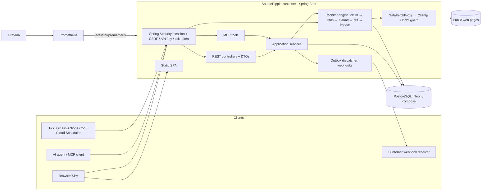
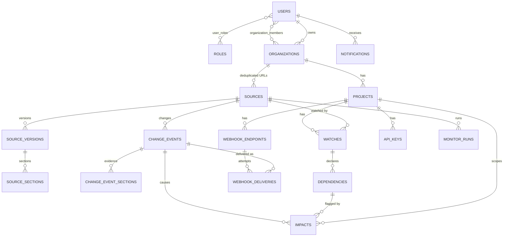
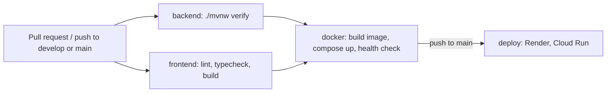

# SourceRipple

**When a webpage changes, SourceRipple shows what changed, which of your projects may depend on
it, and how connected systems can respond.**

SourceRipple watches the public docs, policies and pages your software relies on, records
section-level diffs, matches them against dependencies you declare per project, and flags the
affected projects in a dashboard, by signed webhook, or to AI agents over MCP. It is open source
(Apache-2.0), self-hostable with one `docker compose up`, and runs no paid AI.

> Status: early development (Phase 1, foundation). Live URLs are added after the first release.

| Deployment | URL |
|---|---|
| Render (primary) | _added in Phase 11_ |
| Google Cloud Run | _added in Phase 11_ |

## Contents

1. [Features and roles](#features-and-roles)
2. [Architecture](#architecture)
3. [Data model](#data-model)
4. [API](#api)
5. [Design patterns](#design-patterns)
6. [Run locally](#run-locally)
7. [Testing](#testing)
8. [CI/CD](#cicd)
9. [Deployment](#deployment)
10. [Observability](#observability)
11. [Team, license and notices](#team-license-and-notices)

## Features and roles

Core loop: **monitor a URL → version and section diff → match registered dependencies → impact →
review in the dashboard, signed webhook, or REST/MCP pull.**

_The full feature list is completed as features ship._

| Role | Summary |
|---|---|
| ADMIN | Manages users and roles, monitor runs and failing sources; pauses watches; runs demo controls |
| MAINTAINER | Creates organizations and projects; configures watches, dependencies, webhooks and API keys; reviews impacts |
| REVIEWER | Reads projects, changes and evidence in their organizations and triages impacts |

## Architecture

One Spring Boot modular monolith in one container serves the REST API, the bundled React SPA
(including the marketing site), the MCP endpoint, the demo kit and the monitoring engine.
PostgreSQL is the only stateful dependency.



**Execution model.** No business work runs after a response is sent. Checks run inside a request
or on the internal scheduler thread:

| Environment | `SOURCERIPPLE_SCHEDULER_MODE` | How checks run |
|---|---|---|
| Local / Compose | `internal` | Loop every 60 s |
| Render | `both` | Loop while awake, plus a GitHub Actions tick every 3 h |
| Cloud Run | `external` | Cloud Scheduler tick every hour |

**Repository layout**

| Path | Contents |
|---|---|
| `backend/` | Spring Boot (Java 21, Maven), modules under `io.sourceripple.*` |
| `frontend/` | React 19 + TypeScript + Vite SPA (pnpm) |
| `infra/` | Prometheus, Grafana provisioning, Cloud Run notes |
| `docs/` | Product requirements, development plan, diagrams |
| `scripts/` | Git hooks |

## Data model

PostgreSQL 17, schema owned by Flyway migrations, accessed through Spring Data JPA.



## API

REST under `/api/v1` (JSON, camelCase, UUID IDs, ISO-8601 UTC). Interactive docs: Swagger UI at
`/swagger-ui.html`, OpenAPI document at `/v3/api-docs`.

_The endpoint table is added as controllers ship._

| Controller | Base path | Purpose |
|---|---|---|
| | | |

## Design patterns

| Pattern | Where | Diagram |
|---|---|---|
| Adapter | `SourceAdapter` ← `HtmlPageAdapter`, `RssFeedAdapter` | _docs/diagrams_ |
| Factory | `SourceAdapterFactory` | _docs/diagrams_ |
| Proxy | `SafeFetchProxy` wrapping `OkHttpWebFetcher` | _docs/diagrams_ |
| Bridge | `ChangeNotification` × `NotificationChannel` | _docs/diagrams_ |
| Flyweight | `ExtractionRuleSetPool` | _docs/diagrams_ |
| Singleton | `GlobalFetchLimits` | _docs/diagrams_ |

## Run locally

**Prerequisites:** Docker with Compose v2. For development outside Docker: Java 21, Node.js 22
and pnpm (via `corepack enable`).

```sh
cp .env.example .env          # development-only placeholder values
docker compose up --build
```

| Service | URL |
|---|---|
| App | http://localhost:8080 |
| Health | http://localhost:8080/actuator/health |
| Grafana | http://localhost:3000 (credentials from `.env`) |
| Prometheus | http://localhost:9090 |

Stop and remove data with `docker compose down -v`.

**Development servers**

```sh
cd backend && ./mvnw spring-boot:run -Dspring-boot.run.profiles=local   # needs PostgreSQL and SPRING_DATASOURCE_* set
cd frontend && pnpm install && pnpm dev                                 # http://localhost:5173, proxies /api to :8080
```

Demo accounts: _added with the demo kit._

## Testing

| Suite | Naming | Runner | Command |
|---|---|---|---|
| Unit (service layer, JUnit 5 + Mockito) | `*Test` | Surefire | `cd backend && ./mvnw test` |
| Integration (MockMvc + Testcontainers PostgreSQL) | `*IT` | Failsafe | `cd backend && ./mvnw verify` |
| Frontend gate | — | — | `cd frontend && pnpm lint && pnpm typecheck && pnpm build` |

Integration tests need a running Docker daemon. Reports: `backend/target/surefire-reports`,
`backend/target/failsafe-reports`, coverage in `backend/target/site/jacoco` and `jacoco-it`.
CI uploads all of them as the `backend-reports` artifact.

## CI/CD



- Branches: `main` (production), `develop` (integration), short-lived work branches.
- `main` and `develop` are protected: pull request with one approval from another member,
  required checks `backend`, `frontend`, `docker`, conversation resolution, no force pushes,
  admins included. Full rules: [CONTRIBUTING.md](CONTRIBUTING.md).
- Deployment verification: the deploy job polls `/actuator/info` until `git.commit` equals the
  released SHA.

## Deployment

_Step-by-step guides for Render + Neon and Google Cloud Run + Neon + Cloud Scheduler are added
in Phase 11. Cloud Run notes: [infra/cloudrun/README.md](infra/cloudrun/README.md)._

**Environment variables** (full list with comments in [`.env.example`](.env.example)):

| Variable | Purpose |
|---|---|
| `SPRING_PROFILES_ACTIVE` | `local` or `prod` |
| `SPRING_DATASOURCE_URL` / `_USERNAME` / `_PASSWORD` | JDBC connection (`jdbc:postgresql://<host>/<db>?sslmode=require` for Neon) |
| `PORT` | HTTP port (injected by Render and Cloud Run) |
| `SOURCERIPPLE_PUBLIC_BASE_URL` | Absolute base URL for links |
| `SOURCERIPPLE_ENCRYPTION_KEY` | AES-GCM key for webhook secrets (32 bytes, base64) |
| `SOURCERIPPLE_ADMIN_EMAIL` / `_PASSWORD` | Bootstrap admin |
| `SOURCERIPPLE_METRICS_USERNAME` / `_PASSWORD` | Basic auth for `/actuator/prometheus` |
| `SOURCERIPPLE_TICK_TOKEN` | Token for the scheduler tick endpoint |
| `SOURCERIPPLE_SCHEDULER_MODE` | `internal`, `external` or `both` |
| `SOURCERIPPLE_MIN_INTERVAL_HOURS` | Minimum watch interval |
| `SOURCERIPPLE_FETCH_ALLOW_PRIVATE_TARGETS` | SSRF exemption, local only |
| `SOURCERIPPLE_DEMO_ENABLED` / `_DEMO_WEBHOOK_SECRET` / `_DEMO_USER_PASSWORD` | Demo kit |
| `GIT_COMMIT` | Commit shown in `/actuator/info` (falls back to `RENDER_GIT_COMMIT`) |
| `JAVA_TOOL_OPTIONS` | JVM memory flags |
| `POSTGRES_DB` / `_USER` / `_PASSWORD` | Compose database |
| `GRAFANA_ADMIN_USER` / `_PASSWORD` | Compose Grafana |

## Observability

Spring Boot Actuator exposes `/actuator/health`, `/actuator/info` and `/actuator/prometheus`
(HTTP Basic with the metrics credential). Compose runs Prometheus (scrapes every 15 s) and Grafana
with a provisioned **SourceRipple Overview** dashboard: checks by outcome, fetch latency, changes,
impacts, reviews, webhook deliveries, due and failing sources, HTTP traffic, JVM and connection
pool panels.

## Team, license and notices

| Member | Responsibilities |
|---|---|
| _Lead_ | Repository, CI/CD, infrastructure, integrations, observability, deployments |
| Ajoy | Core backend: identity, workspace, fetching, monitoring, diff, impacts |
| Imrul | Frontend foundation, product screens, notifications, webhooks UI, marketing site |

- Contributing: [CONTRIBUTING.md](CONTRIBUTING.md)
- Security: [SECURITY.md](SECURITY.md)
- License: [Apache-2.0](LICENSE)
- Third-party notices: [THIRD_PARTY_NOTICES.md](THIRD_PARTY_NOTICES.md)
