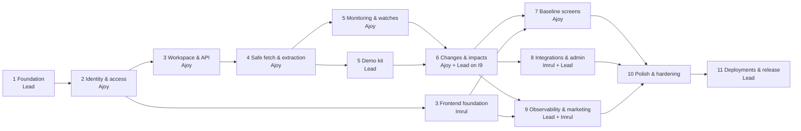

# Phase plan

Derived from PRD §21 (team, phases, calendar, collaboration, scope cuts) and §14 (test IDs). Each phase has its own file in [`phases/`](phases/) with the task checklist.

## Team

| Member | GitHub | Phases led | Role in other phases |
|---|---|---|---|
| **Khalid** (Lead, repository owner) | `khalid999devs` | 1, 8–11 | Reviews Ajoy's PRs (alternating with Imrul); demo kit in Phase 5; pairs on I9 in Phase 6 |
| **Ajoy** | `ajoycodes` | 2–7 | Reviews in 8–11; core bug fixes; pattern class diagrams (Phase 10); production smoke tests (Phase 11) |
| **Imrul** | `kayes2207054` | 8–10 (with Lead) | Frontend foundation in Phase 3; reviews UI conventions in Phase 7; Cloud Run and docs in Phase 11 |

## Phases at a glance

| # | Phase | Owner | Support / parallel | Depends on | PRD refs | Exit criteria (PRD §21.2) |
|---|---|---|---|---|---|---|
| 1 | [Foundation and scaffolding](phases/foundation/phase-01-foundation.md) | Lead | Ajoy, Imrul verify locally | — | §15.1–§15.3 (no deploy jobs), §16, §17.1, Q1–Q6 | Protected `main`/`develop`; CI green on the empty app; `docker compose up --build` starts app and db; every member has cloned the repo, run `scripts/setup-git-hooks.sh` and started the stack locally |
| 2 | [Data model, identity and access](phases/core/phase-02-identity-access.md) | Ajoy | Lead reviews | 1 | §6, §9, FR-AUTH, FR-ADM-1, NFR-SEC-2/3 | RBAC and auth tests green in CI |
| 3 | [Workspace and API foundation](phases/core/phase-03-workspace-api-frontend.md) | Ajoy | **Imrul:** frontend foundation (§8.2–§8.4, S2, S15) | 2 | FR-ORG, FR-PRJ, FR-API | CRUD and error envelope green; login and logout work in the SPA |
| 4 | [Safe fetching and extraction](phases/core/phase-04-safe-fetch-extraction.md) | Ajoy | Lead reviews | 3 | NFR-SEC-1, FR-EXT-1..4, FR-WCH-1, FR-MON-7 | Preview returns sections for HTML and RSS; private targets blocked |
| 5 | [Monitoring engine and watches](phases/core/phase-05-monitoring-watches.md) | Ajoy | **Lead:** demo kit (FR-DEMO-1..6) | 4 | FR-WCH-2..7, FR-EXT-5, FR-MON, FR-DEMO | Fixture watched, baseline READY, a re-check creates no duplicate version |
| 6 | [Change detection, dependencies, impacts](phases/core/phase-06-changes-impacts.md) | Ajoy | Lead pairs on I9 | 5 | FR-EXT-6..9, FR-DEP, FR-IMP | **Golden flow (Appendix A version, change and impact results) green in CI**; webhook and MCP results verified in Phase 8 |
| 7 | [Baseline product screens](phases/core/phase-07-baseline-screens.md) | Ajoy | Imrul reviews UI conventions | 3 (shells), 6 | §8.5 S3–S8, S9 (table), S10, S14 | The whole core loop is usable in the browser end to end |
| 8 | [Integrations and admin](phases/additions/phase-08-integrations-admin.md) | Imrul + Lead | Ajoy reviews | 6 | FR-NTF, FR-WHK (incl. extending the Phase 6 transaction), FR-KEY, FR-MCP, FR-ADM-2..4, S11–S13 | Signed webhook DELIVERED to the demo receiver; admin console works |
| 9 | [Observability and marketing site](phases/additions/phase-09-observability-marketing.md) | Lead + Imrul | Ajoy reviews | 6 (start gate), 3 | §18, FR-WEB, §8.6 | Grafana dashboard live through Compose; landing and pricing reach Lighthouse ≥ 90 locally |
| 10 | [Polish and hardening](phases/additions/phase-10-polish-hardening.md) | Imrul + Lead | **Ajoy:** core bug fixes, pattern diagrams | 8, 9 | §8.4–§8.5, §11.5, §14, §20 | All P0 and P1 items done except deployment; CI green |
| 11 | [Deployments and release](phases/release/phase-11-deployments.md) | Lead | **Imrul:** Cloud Run + docs; **Ajoy:** prod smoke tests | 10 | §15.3 deploy jobs, §17, §20.1 item 10, §20.2 | Both public URLs serve the release SHA; golden flow passes on Render; demo rehearsed |

## Dependency graph

Phases 8 and 9 may overlap Phase 7, because different people own them (PRD §21.3). Phase 9 marketing work starts only after the Phase 6 exit, to protect the core schedule (PRD §22).

## Calendar (PRD §21.3)

The full build fits in **2 weeks**. Exact dates follow the submission date (Q4).

| Week | Phases | Notes |
|---|---|---|
| 1 | 1 (done), 2, 3, 4, 5 | Ajoy on the core; Imrul builds the Phase 3 frontend foundation in parallel; Khalid builds the demo kit and reviews |
| 2 | 6, 7 (Ajoy) overlapping 8, 9 (Khalid, Imrul), then 10 and 11 | Phase 11 starts at least 5 days before submission |

## Review rotation (PRD §21.4)

- Nobody approves their own work. Every PR needs ≥ 1 approval from another member.
- Phases 2–7: Ajoy's PRs **alternate** between Lead and Imrul. Odd-numbered PRs in a phase go to Lead, even-numbered to Imrul. UI PRs in Phase 7 always include Imrul.
- Phases 8–11: Lead and Imrul review each other; Ajoy reviews at least one PR from each of them per phase.
- Parallel tasks: Imrul's Phase 3 PRs are reviewed by Lead; Lead's Phase 5 demo-kit PRs are reviewed by Ajoy.

## Collaboration minimums (PRD §21.4)

Tracked by the Lead at the end of each phase.

| Member | Merged PRs with code (≥ 5) | Reviews given (≥ 5) |
|---|---|---|
| Lead | | |
| Ajoy | | |
| Imrul | | |

Every PR states its phase and PRD IDs (see [README](README.md#traceability-conventions)).

## Deployment-timing safeguards (PRD §21.2 note, §19.3, §22)

Deploying in Phase 11 is a team choice. These keep the "App not deployed" automatic fail from ever being at risk:

- [ ] Phase 1: the production image is built and smoke-tested in the CI `docker` job on every PR.
- [ ] Phase 1: Render, Neon and GCP accounts exist; Q3 answered.
- [ ] §17 and [guides/deployment-runbook.md](guides/operations/deployment-runbook.md) hold the exact steps before Phase 11.
- [ ] Phase 11 starts **at least 5 days before submission**. The Lead puts this date on the board in Phase 1.
- [ ] An optional one-off smoke deploy is allowed at any earlier point (for example after Phase 6).
- [ ] Re-verify free-tier terms (§17.1) at the start of every phase (PRD §22).

## Scope-cut order (PRD §21.5)

If behind schedule, cut in this order and record each cut in the affected issue:

1. MCP write tools (P2), then MCP read tools (keep API keys).
2. Heavy marketing animations and in-app Magic UI accents (landing and pricing stay, static but polished).
3. Dependency Map graph (keep the table view).
4. Overview charts (keep the stat tiles).
5. Webhook test ping and redelivery.

**Never cut:** RBAC, Render auto-deploy, CI/CD, Docker and Compose, tests ≥ 20/10, the core loop (monitor → diff → dependency → impact → review → webhook), README, Prometheus/Grafana, and the RSS adapter.

## Test-ID ownership tracker (PRD §14)

"Phase" is where the test is written (PRD §21.2). Test class names follow [guides/testing.md](guides/engineering/testing.md).

| ID | Class | Phase | Owner | Note |
|---|---|---|---|---|
| U1, U2, U3 | `AuthServiceTest` | 2 | Ajoy | |
| U4 | `OrganizationServiceTest` | 3 | Ajoy | |
| U5 | `MembershipServiceTest` | 3 | Ajoy | |
| U6 | `ProjectServiceTest` | 3 | Ajoy | |
| U7 | `ProjectServiceTest` | 5 | Ajoy | Archive pauses watches once watches exist |
| U8 | `AccessPolicyTest` | 2 | Ajoy | |
| U9, U10 | `WatchServiceTest` | 5 | Ajoy | |
| U11 | `UrlCanonicalizerTest` | 4 | Ajoy | |
| U12, U13 | `SafeFetchProxyTest`, `OkHttpWebFetcherTest` | 4 | Ajoy | Proxy + Singleton evidence |
| U14 | `SourceAdapterFactoryTest` | 4 | Ajoy | Factory |
| U15 | `HtmlPageAdapterTest` | 4 | Ajoy | Adapter |
| U16 | `RssFeedAdapterTest` | 4 | Ajoy | Adapter |
| U17, U18 | `ChangeDetectionServiceTest` | 5 | Ajoy | FR-EXT-5 |
| U19, U20 | `SectionDiffServiceTest` | 6 | Ajoy | |
| U21, U22, U23 | `ImpactServiceTest` | 6 | Ajoy | |
| U24 | `ImpactReviewServiceTest` | 6 | Ajoy | |
| U25 | `WebhookSignerTest` | 8 | Imrul | |
| U26 | `DeliveryServiceTest` | 8 | Imrul | |
| U27 | `NotificationDispatcherTest` | 8 | Imrul | Bridge |
| U28 | `ExtractionRuleSetPoolTest` | 4 | Ajoy | Flyweight |
| U29 | `ApiKeyServiceTest` | 8 | Lead | |
| U30 | `MonitorSchedulerTest` | 5 | Ajoy | |
| U31 | `WaitlistServiceTest` | 9 | Lead | |
| I1 | `AuthFlowIT` | 2 | Ajoy | |
| I2 | `AuthValidationIT` | 2 | Ajoy | |
| I3 | `UnauthenticatedAccessIT` | 2 | Ajoy | |
| I4 | `RoleAccessIT` | 5 | Ajoy | |
| I5 | `AdminAccessIT` | 2 | Ajoy | Uses the FR-ADM-1 users API |
| I6 | `TenantIsolationIT` | 6 | Ajoy | Project, watch and impact cases |
| I7 | `ProjectCrudIT` | 3 | Ajoy | |
| I8 | `WatchCreateIT` | 5 | Ajoy | |
| I9 | `GoldenFlowIT` | 6 | Ajoy + Lead | Webhook (and MCP) assertions added in Phase 8 |
| I10 | `DependencyCrudIT` | 6 | Ajoy | |
| I11 | `ImpactReviewIT` | 6 | Ajoy | |
| I12 | `WebhookDeliveryIT` | 8 | Imrul | |
| I13 | `SsrfBlockIT` | 5 | Ajoy | Watch create; preview case may be added |
| I14 | `ApiKeyAccessIT` | 8 | Lead | |
| I15 | `ErrorEnvelopeIT` | 3 | Ajoy | |
| I16 | `SchedulerTickIT` | 5 | Ajoy | |
| I17 | `WaitlistIT` | 9 | Lead | |

Totals: 31 unit IDs, 17 integration IDs. The Lead audits counts in Phase 10 (targets 31 / 17, TST-R1/R2).
