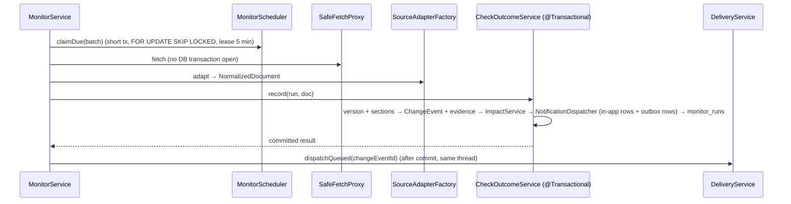

# Architecture guide

Implementation view of PRD §11 (shape, packages, execution model, patterns). The PRD decides *what*; this guide fixes *where* code goes.

## Shape (DEC-03, DEC-04)
One Spring Boot modular monolith in one container. It serves the REST API, the built SPA (marketing + app), `/mcp`, the demo kit and the monitoring engine. PostgreSQL is the only stateful dependency: no broker, no Redis, no second service. See the diagram in PRD §11.1.

## Module map (PRD §11.2)
Root package `io.sourceripple`. Modules are listed bottom-up: a module may depend only on modules **above it in this table** (lower rows depend on upper rows).

| Order | Module | Owns (PRD) | Built in |
|---|---|---|---|
| 0 | `shared` | Error envelope, `GlobalExceptionHandler`, `RequestIdFilter`, `SourceRippleProperties`, `GlobalFetchLimits` (Singleton), `RateLimiter`, time/ID utils, SPA forwarding | 1–4 |
| 1 | `identity` | Users, roles, auth, sessions, bootstrap admin, `AccessPolicy`, session security chain | 2 |
| 2 | `workspace` | Organizations, members, projects | 2 (entities), 3 |
| 3 | `content` | `SourceAdapter`s, `SourceAdapterFactory`, `ExtractionRuleSet`/`ExtractionRuleSetPool` (Flyweight), normalization | 4 |
| 4 | `source` | `UrlCanonicalizer`, sources, watches, `WebFetcher`, `SafeFetchProxy`, `OkHttpWebFetcher`, DNS guard, robots, preview | 4, 5 |
| 5 | `diff` | Versions, section matching, word diff, change events and evidence, `ChangeController` | 5, 6 |
| 6 | `impact` | Dependencies, impact engine, review workflow | 6 |
| 7 | `notify` | `ChangeNotification` × `NotificationChannel` (Bridge), notifications, webhook endpoints, outbox, `DeliveryService`, `WebhookSigner` | 8 |
| 8 | `monitor` | Claims, `MonitorService`, scheduler loop, tick, monitor runs, backoff, pacing, retention, `CheckOutcomeService` | 5, 6 |
| 9 | `integration` | API keys, API-key chain, MCP tools | 8 |
| 9 | `admin` | `AdminService`, `AdminController` | 2 (FR-ADM-1 users and roles), 5 (demo fixture endpoints), 8 (FR-ADM-2..4) |
| 9 | `demo` | Fixture pages, receiver, seeder, demo login and reset (`@ConditionalOnProperty`) | 5, 6, 8, 9 |
| 9 | `marketing` | Waitlist (public endpoint, admin list/export) | 9 |

Note: `source_versions`/`source_sections` entities live in `diff` because `ChangeDetectionService` owns version creation (FR-EXT-5); `source` reads latest sections through `diff/application/VersionQueryService` via the API layer rule below.

## Per-module internal layout
Create only the sub-packages a module needs.

```
io/sourceripple/<module>/
├─ api/              @RestController classes; api/dto/ request and response records
├─ application/      @Service classes (transactions, authorization), ports (interfaces) for upward calls
├─ domain/           @Entity classes, enums, value objects, Spring Data repositories
└─ infrastructure/   adapters to the outside: OkHttp, Jsoup, crypto, security filter chains, @Configuration
```

Any layer package that would hold more than 6 files is split into concept sub-packages (e.g. `source/application/fetch/`, `source/application/watch/`), and no source file exceeds 800 lines ([backend-conventions.md](backend-conventions.md#code-structure)).

Tests mirror this under `backend/src/test/java/io/sourceripple/<module>/...`; shared test support lives in `io/sourceripple/support/`.

## Layering rules (PRD §11.2)
1. **Controllers** validate, call **one** application service and map to a DTO. No business logic, no repositories. A controller may call an application service of another module (it is a composition point), e.g. `diff/api/ChangeController` calls `monitor/application/MonitorRunQueryService` for `/watches/{id}/runs`.
2. **Services** own transactions (`@Transactional`) and authorization (`@PreAuthorize`, `AccessPolicy`).
3. **Repositories** are used only inside their own module. Other modules call that module's services.
4. **Entities never leave the service layer.** Services return DTOs or domain records; controllers never serialize entities.
5. **Application-layer dependencies point down the module order.** No cycles.

## Cross-module calls
When a lower module must trigger something in a higher module, the lower module owns an interface (a *port*) in its `application/` package and the higher module implements it. Spring wires the implementation.

| Port (owner) | Implemented by | Why |
|---|---|---|
| `identity/application/MembershipLookup` | `workspace/application/WorkspaceMembershipLookup` | `AccessPolicy` checks membership (§6.3) |
| `identity/application/OrganizationResolver` | one per resource: `ProjectOrganizationResolver` (workspace), `WatchOrganizationResolver` (source), `ChangeOrganizationResolver` (diff), `DependencyOrganizationResolver`, `ImpactOrganizationResolver` (impact), `WebhookOrganizationResolver` (notify), `ApiKeyOrganizationResolver` (integration) | Resolve resource ID → organization server-side; never trust a client `organizationId` |
| `workspace/application/ProjectArchiveListener` | `source/application/WatchArchiveHandler` | Archiving pauses the project's watches (FR-PRJ-1, U7) |
| `workspace/application/ProjectSummaryContributor` | source (watch counts, failing, last check), impact (impacts by status) | `GET /projects/{id}/summary` (FR-PRJ-2) |
| `source/application/BaselineRunner` | `monitor/application/MonitorService` | Synchronous baseline on watch create (FR-WCH-2) |

All port calls are synchronous and run in the caller's thread (DEC-08). Do not replace them with `@Async` or after-commit async listeners.

## Execution model (DEC-08, PRD §11.3)
- **No business work after the HTTP response is sent.** Work runs inside a request (preview, watch create, manual check, test ping, tick) or on the internal scheduler thread.
- **One entry point:** `MonitorService.runDueWork(Duration budget)` is called by `InternalSchedulerLoop` (every 60 s, mode `internal`/`both`) and by `SchedulerController` (tick, mode `external`/`both`).
- **Check pipeline** (per claimed source):



- **Catch-up:** overdue sources are processed on the next loop or tick.
- **Concurrency:** leases make loop, tick and manual check mutually exclusive per source; the tick itself is single-flight (409 `TICK_IN_PROGRESS`).
- **Per environment:** local `internal`; Render `both` + GitHub cron tick every 3 h; Cloud Run `external` + Cloud Scheduler hourly.

## Security chains (PRD §6.3, §18 OBS-1, §19.2)
Four authentication mechanisms in ordered `SecurityFilterChain` beans, most specific first:

| Order | Chain | Matcher | Auth | Built in |
|---|---|---|---|---|
| 1 | Metrics | `/actuator/prometheus` | HTTP Basic (metrics credential), stateless | 9 |
| 2 | Tick | `/internal/scheduler/tick` | `X-SR-Tick-Token`, stateless | 5 |
| 3 | API key | `/mcp/**` and requests with `Authorization: Bearer sr_…` | API key, stateless, no CSRF | 8 |
| 4 | Session | everything else | Session cookie + CSRF, URL rules of §6.3 | 2 |

## Design patterns (PRD §11.5)
| Pattern | Classes (module/layer) | Phase | Owner | Test |
|---|---|---|---|---|
| Adapter | `content/domain/SourceAdapter` ← `content/infrastructure/HtmlPageAdapter`, `RssFeedAdapter`; target `NormalizedDocument` | 4 | Ajoy | U15, U16 |
| Factory | `content/application/SourceAdapterFactory` | 4 | Ajoy | U14 |
| Proxy | `source/application/WebFetcher` ← `source/infrastructure/fetch/SafeFetchProxy` wrapping `OkHttpWebFetcher` | 4 | Ajoy | U12, U13 |
| Flyweight | `content/application/ExtractionRuleSetPool` sharing immutable `content/domain/ExtractionRuleSet` | 4 | Ajoy | U28 |
| Singleton | `shared/domain/GlobalFetchLimits` (GoF: private constructor, built once, `getInstance()`; also exposed as a bean) | 4 | Ajoy | U12/U13 |
| Bridge | Abstraction `notify/domain/ChangeNotification` (`ImpactNotification`, `SourceChangeNotification`) × implementor `notify/domain/NotificationChannel` (`notify/application/InAppChannel`, `WebhookChannel`); driven by `NotificationDispatcher` | 8 | Imrul | U27 |

Supporting patterns (documented, not counted): Repository, DTO, Transactional Outbox (`webhook_deliveries`), Strategy-like `BackoffPolicy`, layered modular monolith. Diagrams are drawn in Phase 10 under `docs/diagrams/`.

## Frontend shape
One SPA with two code-split shells (marketing, app). See [frontend-conventions.md](frontend-conventions.md). In production the SPA is copied into `src/main/resources/static` by the Dockerfile and served same-origin, so no CORS (NFR-SEC-8).
